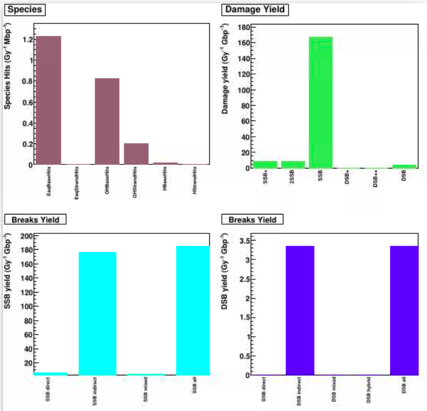

# Protones: de la prueba inicial a las gráficas

[Volver al inicio](index.md)

**Objetivo:** simular protones de **10 MeV** en la misma geometría human_cell.
Primero ejecuta un evento; después, si termina correctamente, prepara cien.
Esta receta todavía no se ha validado mediante una corrida de protones en YUCA.
Los límites de tiempo y memoria son valores de prueba, no garantías de finalización.

## 1. Abrir el entorno

Desde una terminal de YUCA, con el ejemplo ya compilado:

~~~bash
cd ~/G4-molecularDNA
git pull --ff-only
source env/setup.sh
~~~

No necesitas recompilar para cambiar de electrones a protones.
Comprueba que `resources.account` en **config/protons-smoke.json** y
**config/protons.json** corresponda a tu proyecto. Los ejemplos incluyen:

~~~json
"account": "p067"
~~~

Usa una carpeta nueva para cada intento. Si ya existe protons-001, cambia
ese nombre por protons-002 en todos los comandos de la campaña.

## 2. Probar con un protón

~~~bash
python3 scripts/campaign.py prepare config/protons-smoke.json runs/protons-smoke-001 &&
python3 scripts/campaign.py submit runs/protons-smoke-001 --dry-run
~~~

**Comprueba:** aparecen `--array=0-0`, `--mem=10G`, `--time=02:00:00` y
`--account=p067` (o tu proyecto). Después envía una sola vez:

~~~bash
python3 scripts/campaign.py submit runs/protons-smoke-001
~~~

Anota el número recibido y sustituye NUMERO en:

~~~bash
sacct -j NUMERO --format=JobID%25,State%18,ExitCode,Elapsed,MaxRSS
~~~

**Continúa cuando termine con COMPLETED y 0:0.** Comprueba la salida y genera
una primera figura:

~~~bash
python3 scripts/plot_task.py runs/protons-smoke-001 0
~~~

**Debe ocurrir:** se comprueba un primario y se crean human_cell_proton.png y
human_cell_proton.pdf en runs/protons-smoke-001/task_00000/plots/.
Con un evento, algunas categorías pueden quedar en cero: esta prueba comprueba
el funcionamiento, no proporciona estadística suficiente.

Si falla o agota el tiempo, revisa los archivos antes de enviar cien eventos:

~~~bash
cat runs/protons-smoke-001/logs/NUMERO_0.err
tail -n 40 runs/protons-smoke-001/task_00000/simulation.log
~~~

Consulta [errores y soluciones](troubleshooting.md). Conserva la química del
ejemplo: no la desactives ni reduzcas su tiempo para obtener resultados finales.

## 3. Generar cien protones

El archivo config/protons.json prepara **diez trabajos de diez eventos**, todos
a **10 MeV**, con semillas distintas. Slurm puede ejecutar las tareas en paralelo.
Usa la duración y memoria de la prueba para decidir si conviene ajustar
events_per_job o resources.time antes de preparar la campaña.
No supongas que el tiempo crece exactamente en proporción al número de eventos.

~~~bash
python3 scripts/campaign.py prepare config/protons.json runs/protons-001 &&
python3 scripts/campaign.py submit runs/protons-001 --dry-run
~~~

**Comprueba:** `--array=0-9`, `--mem=10G`, `--time=12:00:00` y tu proyecto.

~~~bash
python3 scripts/campaign.py submit runs/protons-001
~~~

## 4. Esperar a que terminen

Sustituye NUMERO por el número de esta campaña:

~~~bash
squeue -r -j NUMERO
sacct -X -j NUMERO --format=JobID%25,State%18,ExitCode,Elapsed
~~~

| Qué aparece | Qué hacer |
| --- | --- |
| RUNNING | Está en ejecución |
| PENDING con JobArrayTaskLimit | Revisa si el array se envió con un límite explícito de concurrencia |
| COMPLETED y 0:0 | Esa tarea terminó sin error de Slurm |
| TIMEOUT, FAILED u OUT_OF_MEMORY | Revisar; no combinar esa tarea |

**Deben aparecer diez tareas COMPLETED y 0:0.** Una cola vacía no confirma
que hayan terminado correctamente. Las figuras se comprobarán en el paso 6.

## 5. Combinar los resultados

Solo cuando las diez tareas hayan terminado correctamente:

~~~bash
hadd -f runs/protons-001/protons_100.root \
  runs/protons-001/task_*/molecular-dna_t0.root
~~~

**Debe ocurrir:** se crea protons_100.root. Conserva los archivos individuales.
`-f` reemplaza el combinado si ya existía. Este comando corresponde a un hilo
por tarea, como en la configuración incluida.

## 6. Comprobar y graficar

~~~bash
root -l -b -q 'analysis/inspect_output.C("runs/protons-001/protons_100.root",100)' &&
root -l -b -q 'analysis/human_cell_proton.C("runs/protons-001/protons_100.root","runs/protons-001/plots_combined")'
~~~

**Debe ocurrir:** primary_source: 100 filas; después se crean un PNG y un PDF.
Comprueba en el resumen **Particle: proton**, **Energy (MeV): 10** y
**Number of Primaries: 100**.

## 7. Abrir las figuras

En el explorador del escritorio YUCA, abre:

~~~text
G4-molecularDNA/runs/protons-001/plots_combined/
~~~

Encontrarás human_cell_proton.png y human_cell_proton.pdf, con los cuatro paneles
de especies, clasificación del daño, roturas simples y roturas dobles.

*Resultado del array de protones ejecutado en YUCA y graficado con `human_cell_proton.C`.*
No esperes los mismos valores que para electrones o alfas. Compara las unidades
y los rendimientos por dosis; un número igual de partículas no implica igual dosis.
Las macros muestran valores centrales, sin incertidumbres estimadas.

Cambiar energía, eventos, proyecto o semillas

Edita config/protons.json antes de preparar una carpeta nueva:

| Cambiar | Campo |
| --- | --- |
| Energía en MeV | energies, por ejemplo [5] para una campaña a 5 MeV |
| Eventos por trabajo | events_per_job |
| Trabajos por energía | replicas |
| Semillas | seed_base; usa un intervalo nuevo para una campaña independiente |
| Proyecto Slurm | resources.account |
| Tiempo | resources.time |

El total es energías × réplicas × eventos por trabajo. Ajusta el número esperado
en inspect_output.C y los nombres de los archivos si cambias ese total.
Para varias energías, prepara una campaña por energía y usa carpetas diferentes:
**no combines energías distintas en un mismo ROOT para esta macro**.
Cambiar un JSON no modifica campañas ya preparadas o enviadas.

